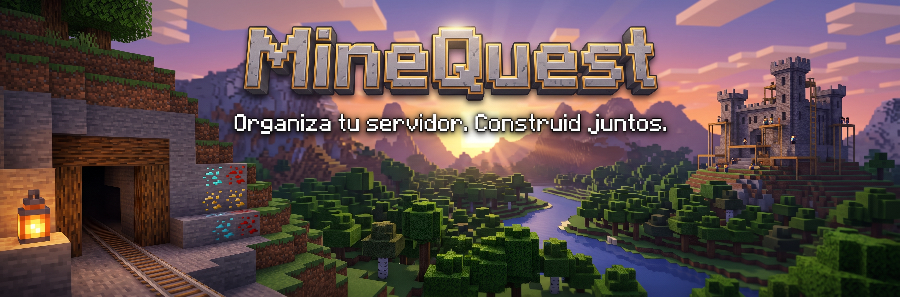

**MineQuest** es una aplicación web desarrollada como proyecto de la asignatura de **Desarrollo Web en Entorno Servidor**, del segundo curso del Ciclo Formativo de Grado Superior de Desarrollo de Aplicaciones Web (DAW).

El proyecto tiene como objetivo facilitar la organización de las tareas de Minecraft, tanto para jugadores que juegan solos como para grupos de amigos que comparten un servidor, permitiendo registrar los objetivos que quieren realizar y llevar un seguimiento de ellos.

- **Versión:** 1.0.0
- **Integrantes:**
  - David Crisbasianu Petronga
  - Samuel Alonso Álvarez
  - Álvaro Cabrejas Ormeño

## Sobre el proyecto

La aplicación se organiza mediante ***Vertical Slicing***, separando el código por funcionalidades en dos slices:

- **`tarea`:** agrupa los elementos relacionados con la gestión de tareas.
- **`common`:** contiene los elementos compartidos por las distintas funcionalidades, como el manejo global de errores.

Dentro de cada slice se aplica ***Clean Architecture***, que separa el código en tres capas con responsabilidades distintas: `domain`, `application` e `infraestructure`.

Esta organización permite ampliar el proyecto de forma progresiva, añadiendo nuevas funcionalidades sin modificar las ya existentes.

## Funcionalidades

La aplicación permite gestionar tareas mediante las siguientes operaciones:

| Método HTTP | Ruta | Operación |
|---|---|---|
| GET | `/tareas` | Consultar todas las tareas |
| GET | `/tareas/prioridad/{prioridad}` | Consultar las tareas de una prioridad |
| POST | `/tareas` | Crear una tarea |
| PUT | `/tareas/{id}` | Modificar una tarea |
| DELETE | `/tareas/{id}` | Eliminar una tarea |

Además, incluye:

- **Validación de datos** en la creación y la modificación, con una validación personalizada para el tipo de tarea.
- **Manejo global de errores**, que devuelve el código HTTP adecuado en cada caso (400, 404 y 500).

## Ejecución rápida

Requisitos: Java 17 o superior y Maven.

```bash
mvn spring-boot:run
```

Una vez iniciada, la aplicación está disponible en `http://localhost:8080/tareas`.

Más detalles en [Ejecución y pruebas](doc/04-ejecucion-y-pruebas.md) y en el [Manual de usuario](doc/07-manual-de-usuario.md).

## Documentación

La carpeta [`doc/`](doc/) recoge la documentación completa del proyecto:

| Apartado | Documento |
|---|---|
| Contexto de la aplicación | [01 - Contexto](doc/01-contexto.md) |
| Diseño | [02 - Diseño](doc/02-diseno.md) |
| Implementación | [03 - Implementación](doc/03-implementacion.md) |
| Ejecución y pruebas | [04 - Ejecución y pruebas](doc/04-ejecucion-y-pruebas.md) |
| Herramientas y versiones | [05 - Herramientas y versiones](doc/05-herramientas-y-versiones.md) |
| Elementos destacables | [06 - Elementos destacables](doc/06-elementos-destacables.md) |
| Manual de usuario | [07 - Manual de usuario](doc/07-manual-de-usuario.md) |
| Conclusiones | [08 - Conclusiones](doc/08-conclusiones.md) |
| Referencias y bibliografía | [09 - Referencias y bibliografía](doc/09-referencias-y-bibliografia.md) |
