# 4. Ejecución y pruebas

## 4.1. Ejecución de la aplicación

### Requisitos

- Java 17 o superior.
- Maven (o el Maven Wrapper incluido en el proyecto).

### Arranque

Desde la raíz del proyecto se ejecuta:

```bash
mvn spring-boot:run
```

Cuando la aplicación está lista, en la consola aparece el mensaje `Started MinequestApplication`. Por defecto escucha en el puerto `8080`.

### Acceso

| Recurso | Dirección |
|---|---|
| Listado de tareas | `http://localhost:8080/tareas` |
| Formulario de creación | `http://localhost:8080/formulario-crear-tarea.html` |

El resto de operaciones (modificar, borrar y listar por prioridad) se prueban con `curl` desde la terminal. Al final de cada comando se añade `; echo` para que la salida termine en una línea nueva y se lea mejor.

Los datos se guardan en memoria. Al arrancar, la aplicación carga tres tareas de demostración (ids 1, 2 y 3), y cualquier cambio se pierde al detenerla.

## 4.2. Plan de pruebas

Las pruebas son manuales y siguen el plan del apartado [2.5](02-diseno.md#25-plan-de-pruebas). Para cada funcionalidad se comprueba:

1. **El funcionamiento correcto**, con datos válidos.
2. **La respuesta ante un error**, con datos no válidos o recursos que no existen.

Las pruebas se ejecutan **en orden** y con la aplicación recién arrancada, porque cada una parte del estado que deja la anterior (por ejemplo, P04 comprueba la tarea creada en P03).

## 4.3. Evidencias de ejecución

### P01 · Arranque de la aplicación

**Acción:** se arranca la aplicación desde la terminal.

```bash
./mvnw spring-boot:run
```

**Resultado esperado:** la consola muestra `Started MinequestApplication` y `Tomcat started on port 8080`.

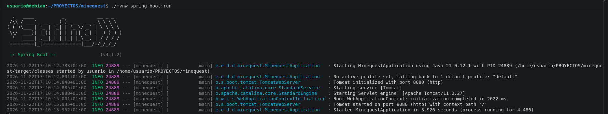

**Resultado obtenido:** correcto, la aplicación arranca en el puerto 8080.

### P02 · Listar tareas

**Acción:** se abre en el navegador `http://localhost:8080/tareas`.

**Resultado esperado:** código 200 y un JSON con las tres tareas de demostración.

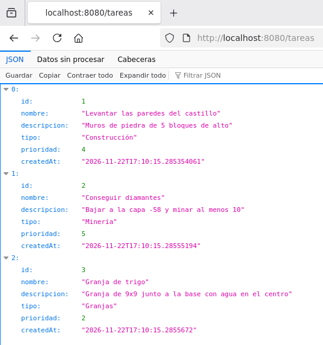

**Resultado obtenido:** correcto, se muestran las tareas 1 ("Levantar las paredes del castillo"), 2 ("Conseguir diamantes") y 3 ("Granja de trigo").

### P03 · Crear una tarea

**Acción:** desde el formulario `http://localhost:8080/formulario-crear-tarea.html` se crea una tarea con estos datos:

| Campo | Valor |
|---|---|
| Nombre | Granja de hierro |
| Descripción | Granja con aldeanos y un zombi |
| Tipo | Granjas |
| Prioridad | 4 |

**Resultado esperado:** código 200 y una página con los datos de la nueva tarea y su identificador.

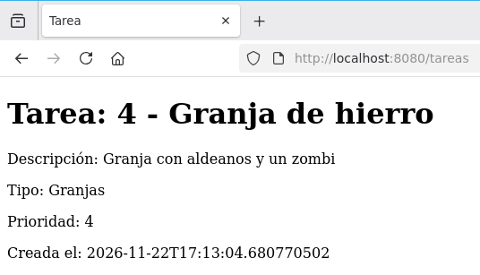

**Resultado obtenido:** correcto, se muestra "Tarea: 4 - Granja de hierro" con su descripción, tipo, prioridad y fecha de creación.

### P04 · Listar tras crear

**Acción:** se vuelve a abrir `http://localhost:8080/tareas`.

**Resultado esperado:** la tarea creada en P03 aparece en el listado.

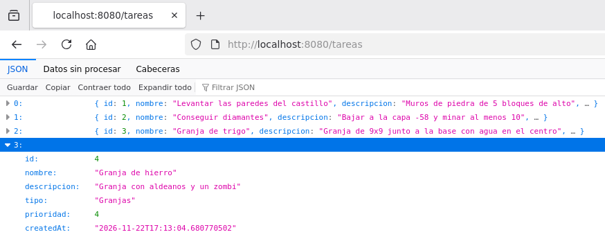

**Resultado obtenido:** correcto, aparecen cuatro tareas. La última es "Granja de hierro" con id 4.

### P05 · Modificar una tarea

**Acción:** se modifica la tarea 2 enviando todos sus datos, con una nueva descripción y una nueva prioridad.

```bash
curl -i -X PUT http://localhost:8080/tareas/2 -H "Content-Type: application/json" -d '{"nombre":"Conseguir diamantes","descripcion":"Minar 20 diamantes","tipo":"Minería","prioridad":3}'; echo
```

**Resultado esperado:** código 200 y el JSON de la tarea con los datos actualizados. El `id` y la fecha de creación no cambian.

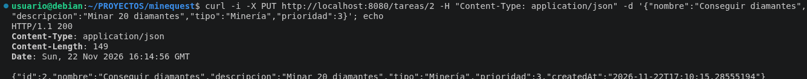

**Resultado obtenido:** correcto. `HTTP/1.1 200` y `{"id":2,"nombre":"Conseguir diamantes","descripcion":"Minar 20 diamantes","tipo":"Minería","prioridad":3,...}`.

### P06 · Listar por prioridad

**Acción:** se piden las tareas con prioridad 4.

```bash
curl -i http://localhost:8080/tareas/prioridad/4; echo
```

**Resultado esperado:** código 200 y solo las tareas con prioridad 4.

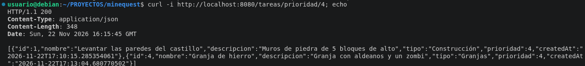

**Resultado obtenido:** correcto, se devuelven la tarea 1 ("Levantar las paredes del castillo") y la 4 ("Granja de hierro"). La 2 ya no aparece, porque en P05 se le cambió la prioridad a 3.

### P07 · Eliminar una tarea

**Acción:** se elimina la tarea 3.

```bash
curl -i -X DELETE http://localhost:8080/tareas/3; echo
```

**Resultado esperado:** código 204, sin contenido.

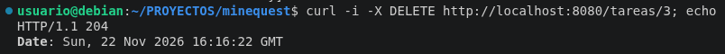

**Resultado obtenido:** correcto, `HTTP/1.1 204`.

### P08 · Listar tras eliminar

**Acción:** se vuelve a abrir `http://localhost:8080/tareas`.

**Resultado esperado:** la tarea 3 ya no aparece.

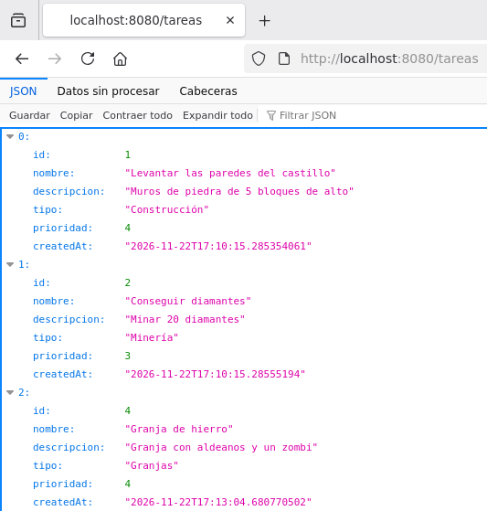

**Resultado obtenido:** correcto, aparecen las tareas 1, 2 (con los datos modificados en P05) y 4. Los cambios se mantienen entre peticiones.

### P09 · Validaciones estándar

**Acción:** se intenta crear una tarea con el nombre vacío y la prioridad 9.

```bash
curl -i -X POST http://localhost:8080/tareas -d "nombre=" -d "tipo=Construcción" -d "prioridad=9"; echo
```

**Resultado esperado:** código 400 y los mensajes de error de `messages.properties` para el nombre (`@NotBlank`) y la prioridad (`@Max`).

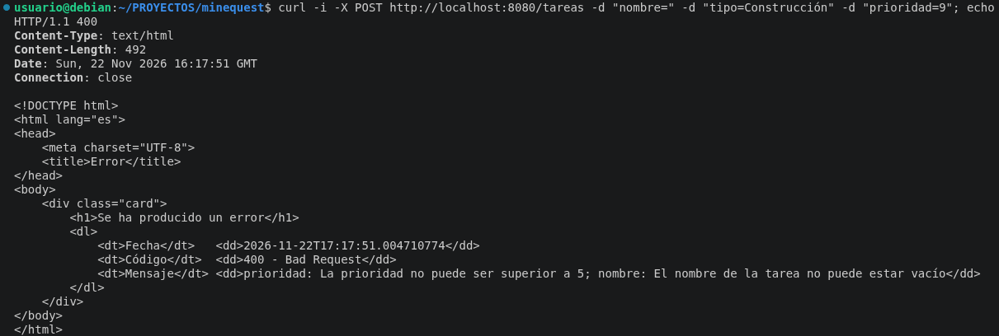

**Resultado obtenido:** correcto, `HTTP/1.1 400` y la página de error con el mensaje "prioridad: La prioridad no puede ser superior a 5; nombre: El nombre de la tarea no puede estar vacío". El orden de los errores puede variar.

### P10 · Validación personalizada (tipo de tarea)

**Acción:** se intenta crear una tarea con un tipo que no existe.

```bash
curl -i -X POST http://localhost:8080/tareas -d "nombre=Castillo" -d "tipo=Pesca" -d "prioridad=3"; echo
```

**Resultado esperado:** código 400 y el mensaje de la validación `@TipoTarea`.

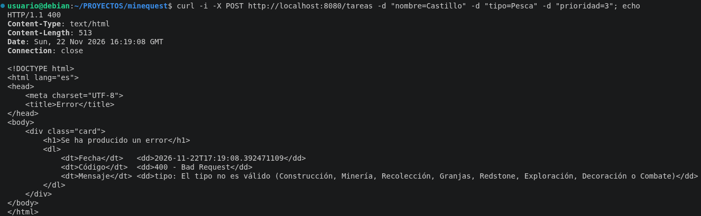

**Resultado obtenido:** ✅ `HTTP/1.1 400` y "tipo: El tipo no es válido (Construcción, Minería, Recolección, Granjas, Redstone, Exploración, Decoración o Combate)".

### P11 · Tarea inexistente

**Acción:** se intenta eliminar una tarea que no existe.

```bash
curl -i -X DELETE http://localhost:8080/tareas/99; echo
```

**Resultado esperado:** código 404 y la página de error con el mensaje de `TareaNotFoundException`.

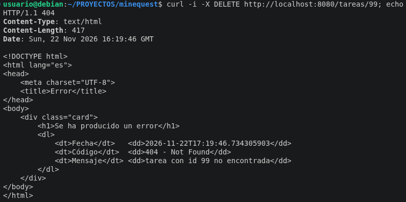

**Resultado obtenido:** correcto, `HTTP/1.1 404` y "tarea con id 99 no encontrada".

### P12 · Prioridad sin tareas

**Acción:** se piden las tareas con una prioridad que no tiene ninguna.

```bash
curl -i http://localhost:8080/tareas/prioridad/1; echo
```

**Resultado esperado:** código 404 y el mensaje "No hay tareas con prioridad 1".

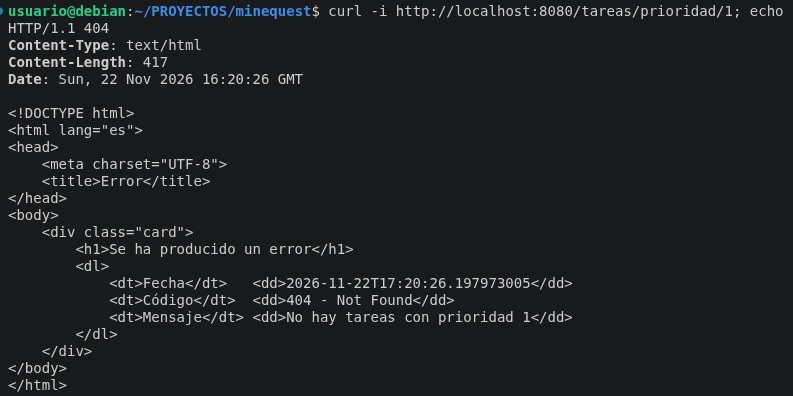

**Resultado obtenido:** correcto, `HTTP/1.1 404` y "No hay tareas con prioridad 1".

### P13 · Parámetro de ruta incorrecto

**Acción:** se intenta eliminar una tarea indicando un texto en lugar de un número.

```bash
curl -i -X DELETE http://localhost:8080/tareas/abc; echo
```

**Resultado esperado:** código 400, porque el identificador no es un número. El error lo recoge el manejador global.

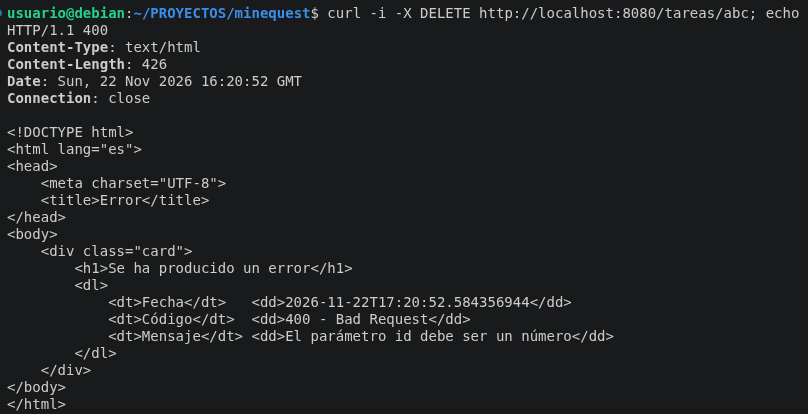

**Resultado obtenido:** correcto `HTTP/1.1 400` y "El parámetro id debe ser un número".

---

[Anterior: Implementación](03-implementacion.md) | [Índice](../README.md) | [Siguiente: Herramientas y versiones](05-herramientas-y-versiones.md)
